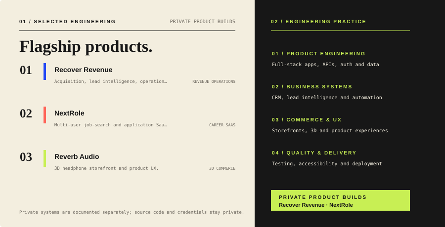

  <a href="https://sierra-portfolio-beige.vercel.app/">PORTFOLIO</a> ·
  <a href="https://github.com/zoeyzb/selected-work">SELECTED WORK & PRIVATE PROJECT CASE STUDIES</a> ·
  <a href="https://www.linkedin.com/in/sierra-byrd-804926403/">LINKEDIN</a> ·
  <a href="mailto:sierra@recoverrevenue.company">CONTACT</a>

## Flagship product systems

These are the larger products where the most substantial engineering work lives. Their source repositories remain private; the public case studies include screenshots, system design, implementation scope and verification boundaries.

<table>
<tr>
<td width="50%" valign="top">

### Recover Revenue · Recover Operator OS

**Full-stack acquisition and revenue-operations platform**

Public acquisition site connected to private lead intelligence, website audits, qualification, personalized outreach, follow-up, owner CRM, workflow approvals and operational monitoring.

**802 tests passed across 173 test files** in the inspected local workspace.

[Case study](https://github.com/zoeyzb/selected-work/blob/main/case-studies/recover-revenue.md) · [Live website](https://recoverrevenue.company/)
</td>
<td width="50%" valign="top">

### NextRole

**Multi-user career and application workspace**

Role discovery, job imports, structured résumé editing, approved-facts generation, ATS analysis, application materials, review-first automation and opportunity tracking.

**119 frontend tests and 4 security checks passed.** Backend verification notes and its current provider-model test mismatch are documented in the case study.

[Case study](https://github.com/zoeyzb/selected-work/blob/main/case-studies/nextrole.md) · [Product](https://nextrolehq.com/)
</td>
</tr>
<tr>
<td width="50%" valign="top">

### Reverb Audio

**3D commerce and product experience**

Interactive headphone storefront with procedural product geometry, material selection, responsive product storytelling, a persistent shopping bag, quantity controls, subtotal calculations and sample-order export.

[Case study](https://github.com/zoeyzb/selected-work/blob/main/case-studies/reverb-audio.md) · [Live experience](https://reverb-audio.vercel.app/)
</td>
<td width="50%" valign="top">

### Lead Intelligence & Outreach

**Research, qualification and business automation**

A system organizing 1,000+ prospect records, website evidence, audit findings, qualification signals, personalized outreach and staged follow-up. This is part of the wider Recover Revenue operating system.

[Case study](https://github.com/zoeyzb/selected-work/blob/main/case-studies/lead-intelligence.md)
</td>
</tr>
</table>

## Engineering evidence

| Project | Verified or documented evidence |
|---|---|
| Recover Revenue | **802 passing tests** across 173 test files; fresh local run November 14, 2026 |
| NextRole | **119 frontend + 4 dependency-security tests passed**; backend run: 332 passed, 1 failed on a Gemini model fallback assertion |
| RevenueOS | **96 smoke checks passed**; interactive dashboard uses illustrative sample data |
| Conversational Voice Agent & QA | **146 automated tests** documented for call flows, interruptions, silence fallback and failure cases |
| Telescope Scheduling | **100+ automated tests** documented for scheduling constraints and edge cases |
| Lead Intelligence & Outreach | **1,000+ prospect records** organized for research and qualification |

These are project-specific engineering measures, not customer counts, revenue claims or production-usage metrics.

## Additional engineering work

- **Conversational Voice Agent & QA Pipeline** — Python, LiveKit, Deepgram and Groq; structured inquiry capture, escalation, follow-up and owner review. [Case study](https://github.com/zoeyzb/selected-work/blob/main/case-studies/voice-agent-qa.md)
- **Telescope Scheduling System** — Python and Astroplan; observation windows, scheduling constraints and edge cases. [Case study](https://github.com/zoeyzb/selected-work/blob/main/case-studies/telescope-scheduling.md)
- **Aluminum Price Forecasting** — Pandas, Prophet and Flask; historical data from 2008–2024 and a 90-day forecast workflow. [Case study](https://github.com/zoeyzb/selected-work/blob/main/case-studies/aluminum-forecasting.md)
- **3D Zombie Survival Game** — Godot, GDScript and Blender; gameplay systems, physics, enemy behavior and 3D assets. [Case study](https://github.com/zoeyzb/selected-work/blob/main/case-studies/zombie-survival.md)
- **ForYouHub Commerce & Growth Operations** — Shopify, UGC creative, TikTok advertising, SEO, analytics, customer support and order workflows. [Case study](https://github.com/zoeyzb/selected-work/blob/main/case-studies/foryouhub.md)
- **Reusable SaaS Starter** — product foundation associated with a 500-person waitlist; the figure is not presented as paying customers or active users. [Case study](https://github.com/zoeyzb/selected-work/blob/main/case-studies/saas-starter.md)
- **Crypto Research & Automated Trading** — five-year historical data, backtesting, signal generation, risk controls and Binance integration. No current profit claim. [Case study](https://github.com/zoeyzb/selected-work/blob/main/case-studies/crypto-research.md)

## Selected public builds

- **[RevenueOS](https://github.com/zoeyzb/saas)** — revenue-intelligence dashboard with CRM, pipeline, recurring revenue, transactions and reporting. 96 local smoke checks passed; records are illustrative sample data.
- **[Wok Hei](https://github.com/zoeyzb/wok-kai-food-)** — restaurant website with interactive menu, gallery, sample stories, local ordering-bag preview and reservation enquiry form. Menu prices and stories are illustrative; no order/payment is collected.
- **[Hale Marchetti Reyes](https://github.com/zoeyzb/law-2)** — criminal-defense website concept with responsive practice-area navigation and a validated inquiry endpoint. The firm, attorneys, case results and reviews are fictional.
- **[Maison Aurelle](https://github.com/zoeyzb/Masion-Aureolle-saloon)** — salon website with service discovery, before/after comparisons, reduced-motion support and appointment-request email handling. Requests are not confirmed appointments.
- **[Law Your Way](https://github.com/zoeyzb/criminal-law)** — React/Vite legal website concept with accessible preparation checklists and responsive UI.
- **[ALBA Massage & Wellness](https://github.com/zoeyzb/alba-massage-spa)** — editorial spa website concept with treatment discovery and email-enquiry fallback.

## Technical toolkit

- **Languages:** TypeScript, JavaScript, Python, SQL, HTML/CSS, Java, C++, Rust and GDScript.
- **Frontend & interaction:** React, Next.js, Vite, Tailwind CSS, Three.js, React Three Fiber, GSAP and Framer Motion.
- **Backend & data:** Node.js, FastAPI, Flask, PostgreSQL, Supabase, Neon, REST APIs, authentication and workflow services.
- **AI & integrations:** OpenAI APIs, LiveKit, Deepgram, Groq, MCP, speech workflows and service integrations.
- **Quality & delivery:** Vitest, Pytest, Playwright, TypeScript checks, linting, CI, responsive QA and Vercel deployment.

## Private work and activity

Private source repositories, credentials, customer records and provider configuration remain private. This profile uses GitHub's native contribution graph rather than a second, decorative activity heatmap. Private-contribution visibility is already enabled, so GitHub can include anonymized private activity without exposing repository names or code.
