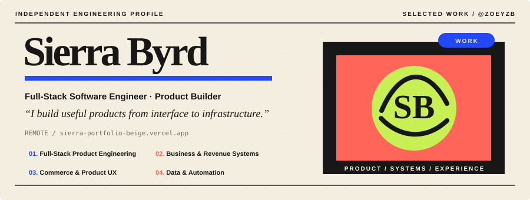

<strong>Full-stack software engineer building useful products, AI systems, and the workflows behind them.</strong>

  <a href="https://sierra-portfolio-beige.vercel.app/">PORTFOLIO</a> ·
  <a href="https://www.linkedin.com/in/sierra-byrd-804926403/">LINKEDIN</a> ·
  <a href="mailto:sierra@recoverrevenue.company">EMAIL</a> ·
  <a href="https://github.com/zoeyzb">GITHUB</a>

Open to remote software engineering opportunities.

## What I build

- **Product engineering:** Full-stack applications, APIs, authentication, databases and deployment.
- **AI and voice systems:** Agent workflows, voice interfaces, speech pipelines and tool integrations.
- **Workflow and data:** Lead acquisition, qualification, CRM workflows, enrichment and automation.
- **Interactive experiences:** Responsive interfaces, 3D experiences, motion and product-focused UX.

I work across the product lifecycle: understanding the problem, shaping the interface, implementing the backend and data flow, integrating services, and checking that the important paths actually work.

## Selected work

### Private product systems

- **[Recover Revenue](https://recoverrevenue.company/)** · [Technical case study](./case-studies/recover-revenue.md) — Full-stack growth platform spanning public acquisition, SEO/search, buyer journeys, lead discovery and qualification, outreach, follow-up, owner operations and conversion tracking. The public website is live; the internal source remains private.
- **[NextRole](https://next-role-web-nine.vercel.app/)** · [Technical case study](./case-studies/nextrole.md) — Job-search workspace for role discovery, posting imports, résumé and application preparation, review-first automation and application tracking. In active development; external provider capabilities depend on configuration.

### Public engineering repositories

- **[YOURAGENT](https://github.com/zoeyzb/YOURAGENT)** — Multi-tenant AI voice-agent SaaS with organization-scoped data, encrypted runtime credentials, agent versioning, guarded deployment and call-history evidence.
- **[TasteAtlas AI](https://github.com/zoeyzb/afterglow-qloo-agent)** — Interactive 3D cultural discovery using Qloo API orchestration and explainable recommendations. The sample atlas is explicitly illustrative; live results still require validation with the event-issued key.
- **[ChatGPT SMS MCP](https://github.com/zoeyzb/chatgpt-sms-mcp)** — Local MCP server for macOS Messages and Google Voice, with two-step send confirmation, idempotency, recipient allowlists and hourly send limits.

### Product and interface work

- **[RevenueOS](https://github.com/zoeyzb/saas)** — Revenue-intelligence dashboard demo covering CRM, pipeline, marketing, retention, subscriptions, transactions and reporting. Uses illustrative sample data rather than a live production backend; its local smoke suite passed 96 checks during this audit.
- **[Chroma Hair Atelier](https://github.com/zoeyzb/chroma-hair-)** — Responsive salon website with service navigation and an appointment-request builder; real booking integration is not connected.
- **[HEYREN](https://github.com/zoeyzb/HEYREN)** — 3D, voice-first assistant experience with scripted conversation previews and selectable workflows. The showcase is illustrative; it does not place live calls or write to a real CRM/calendar.

### Private voice QA system

- **Patient Voice QA Harness** · [Technical case study](./case-studies/patient-voice-qa.md) — Synthetic-patient voice QA using LiveKit Agents, Deepgram and Groq, with scripted scenarios, separate audio tracks, timestamped transcripts and evidence-backed evaluation. Offline implementation is distinct from live-call validation, which is not claimed as complete.

## Technical toolkit

- **Languages:** TypeScript, JavaScript, Python, SQL, HTML and CSS; additional experience with Java, C++, Rust and GDScript.
- **Frontend:** React, Next.js, Vite, Tailwind CSS, Three.js, React Three Fiber, GSAP and Framer Motion.
- **Backend and data:** Node.js, FastAPI, Flask, PostgreSQL, Supabase, Neon, REST APIs and authentication.
- **AI and integrations:** OpenAI APIs, LiveKit, Deepgram, Groq, Qloo, MCP servers, voice workflows and browser automation.
- **Quality and delivery:** Vitest, Pytest, Playwright, TypeScript checks, linting, CI workflows and Vercel deployments.

## Contribution activity and stack

<!-- readme-atelier:start -->
<!-- Generated by Readme Atelier (https://github.com/monokernn/readme-atelier). Edit atelier.yml instead of this block. -->

<picture><source media="(prefers-color-scheme: dark)" srcset="./atelier/activity-dark.3d2231f4.svg"/></picture>

<picture><source media="(prefers-color-scheme: dark)" srcset="./atelier/stack-dark.9b667816.svg"/></picture>

<!-- readme-atelier:end -->

---

Paper Signal visual system adapted from <a href="https://github.com/Jenesyx/pretty-github">Pretty GitHub</a>. Dynamic activity and stack cards generated by <a href="https://github.com/monokernn/readme-atelier">Readme Atelier</a>. See <a href="./THIRD_PARTY_NOTICES.md">third-party notices</a>.

